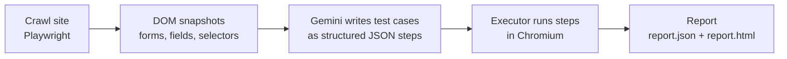

# PsychicTells AI Test Agent

An AI-driven end-to-end test agent for web apps, built with **Python, Playwright and the Gemini API**. It crawls a site, asks Gemini to write executable test cases from the live DOM, runs them in a real browser, and produces a JSON + HTML report.

It was built against a live consumer web app (a psychic-reading platform with user accounts, a Q&A flow, payments and a separate expert dashboard), and is configurable for other sites through a JSON profile.

## What it does



1. **Crawl** the target site and capture each page's forms, fields and selectors.
2. **Generate** test cases with Gemini. Each test is a list of typed steps (`goto`, `fill`, `click`, `select`, `wait`, `wait_visible`, `assert_visible`, `assert_not_visible`, `assert_text`, `assert_url`, `screenshot`), so the model's output can be run directly with no code generation.
3. **Execute** the steps with Playwright, taking a screenshot on failure.
4. **Report** results as `reports/<run_id>/report.json` and a visual `report.html` (summary, crawled pages, generated-vs-run counts, per-test steps, inputs and failure screenshots).

### Two modes

| Mode | Command | What happens |
|---|---|---|
| Full site | `python main.py` | Crawls everything, generates up to `--max-tests` tests (default 30) |
| Targeted | `python main.py --prompt "Test login with valid and invalid credentials"` | Skips the full crawl. Gemini reads the plain-English instruction, picks the relevant pages, checks their DOM, and generates focused tests |

If no `GEMINI_API_KEY` is set (or generation produces nothing in full-site mode), it falls back to a set of hand-written suites (navigation, ask-a-question, user auth) and writes a report from those.

## Engineering details worth a look

- **Gemini client without an SDK** (`agent/gemini_client.py`): calls the REST API with the standard library, tries an ordered list of fallback models, and retries on HTTP 429/5xx with capped exponential backoff.
- **Resilient clicks** (`agent/executor.py`): native click first, detects new tabs and switches to them, and falls back to a dispatched click event when the URL does not change. Covered by unit tests in `tests/`.
- **Cold-start handling** (`agent/crawler.py`): wakes a sleeping free-tier host (e.g. Render) before crawling, so the first run does not fail on timeouts.
- **Multi-site profiles** (`site_profiles/*.json`, `test_agent/site_profile.py`): URLs, selectors and credential env-var names live in a JSON profile, so pointing at another site means adding a profile, not editing Python. See `site_profiles/TEMPLATE.json`.
- **Supporting modules** in `test_agent/`:
  - `self_healer.py`: tries a cascade of fallback strategies (configured alternatives, visible text, aria attributes, partial attribute match, position) when a selector breaks, and logs each heal.
  - `ui_change_detector.py`: captures a baseline of key pages and flags DOM, title, status and (with Pillow) pixel-level changes.
  - `intelligent_reporter.py`: severity scoring, grouping by root cause, and run history.
  - `auth_helper.py`: one shared login helper that separates "credentials rejected" from "we cannot tell what happened".

## Project structure

```
├── main.py                  # entry point (full-site and targeted modes)
├── config.py                # loads the active site profile + env settings
├── agent/                   # the AI pipeline
│   ├── crawler.py           #   crawl + DOM extraction
│   ├── test_generator.py    #   full-site test generation (Gemini)
│   ├── targeted_generator.py#   --prompt mode
│   ├── gemini_client.py     #   REST client, model fallback, retries
│   ├── executor.py          #   runs TestCase steps with Playwright
│   ├── models.py            #   dataclasses: PageSnapshot, TestStep, TestCase, results
│   └── reporter.py          #   JSON + HTML report
├── test_agent/              # hand-written suites + self-healing, UI diff, reporting
│   └── tests/               #   auth, ask-question, payment, chat, expert panel, navigation...
├── site_profiles/           # per-site config (psychictells.json, TEMPLATE.json)
└── tests/                   # unit tests for the executor
```

## Setup

Requires Python 3.9+.

```bash
python -m venv venv
source venv/bin/activate          # Windows: venv\Scripts\activate
pip install -r requirements.txt
playwright install chromium
cp .env.example .env              # then fill it in
```

In `.env`, set `GEMINI_API_KEY` (from Google AI Studio) and, for the login/auth tests, test-account credentials for the target site. **Credentials are read only from environment variables. Never commit `.env`.**

## Usage

```bash
python main.py                                    # full crawl + generate + run
python main.py --prompt "Verify psychics page filters work correctly"
python main.py --headless false                   # watch the browser
python main.py --max-tests 20
python main.py --site my_other_site               # use site_profiles/my_other_site.json
```

Run the unit tests:

```bash
python -m pytest tests/
```

## Testing a different site

1. Copy `site_profiles/TEMPLATE.json` to `site_profiles/<name>.json` and fill in URLs and selectors.
2. Run `python main.py --site <name>` (or set `SITE_PROFILE=<name>`).

Note: the Gemini prompts in `agent/test_generator.py` and `agent/targeted_generator.py` currently include verified selector facts for the PsychicTells site, so a new site will work best after those are generalised.

## Limitations

- The self-healer's last planned strategy (Gemini-suggested selectors) is described in its docstring but not implemented.
- Only the navigation, ask-a-question and auth suites run through the fallback path. The other hand-written suites (payment, chat, expert panel, UI regression, self-healing, click interactions) can be imported and run, but there is no command-line runner for them yet.
- AI-generated tests are not deterministic: two runs can produce different test cases.
- Targets a live site, so results depend on its availability and data.
- Unit tests currently cover the executor's click handling only.

## Responsible use

Point this only at sites you own or have permission to test, using dedicated test accounts.
